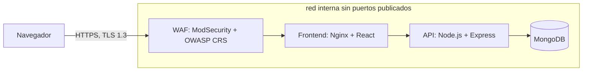

# CMS seguro: construcción, evaluación y operación

Proyecto final del curso **Seguridad en Aplicaciones** de la Maestría en Seguridad Informática (Universidad Mariano Gálvez de Guatemala), opción B: aplicación cloud-native.

Es un sistema de gestión de contenidos (CMS) construido desde cero con React, Node.js y MongoDB, y sometido a un ciclo completo de seguridad: diseño seguro, análisis de riesgos, pruebas de penetración, endurecimiento, arquitectura en la nube como código, DevSecOps y operación.

## Características

- Sitio público con publicaciones en Markdown y panel de administración.
- Tres roles: **lector**, **editor** (sus propias publicaciones e imágenes) y **administrador** (usuarios, roles y auditoría).
- Autenticación con argon2id, sesión en cookie `HttpOnly` y segundo factor TOTP (obligatorio para el administrador).
- Subida segura de imágenes (tipo por contenido, tamaño, nombre aleatorio).
- Auditoría persistente de las operaciones de escritura.

## Arquitectura



Solo el WAF publica un puerto (`127.0.0.1:8443`). La API y la base de datos viven en una red interna de Docker. La arquitectura objetivo en AWS (ALB con WAF, ECS Fargate, DocumentDB, S3, KMS y Secrets Manager) está escrita como código en `infra/terraform` y **no se despliega**; ver `docs/arquitectura.md`.

## Controles de seguridad principales

| Área | Controles |
|---|---|
| Autenticación | argon2id, mínimo de 10 caracteres, rechazo de contraseñas comunes, MFA TOTP con semilla cifrada (AES-256-GCM), bloqueo tras intentos fallidos |
| Sesión | JWT en cookie `HttpOnly`, `Secure` y `SameSite=Strict`; vigencia de 30 minutos; revocación al cerrar sesión |
| Autorización | Roles verificados en el servidor y control de propietario en publicaciones e imágenes |
| Entradas | Validación estricta con Zod (rechaza campos desconocidos), `sanitizeFilter` de Mongoose, Markdown sin HTML crudo |
| Perímetro | WAF con OWASP CRS, TLS 1.3 exclusivo, CORS acotado, cabeceras CSP, HSTS y COOP, COEP y CORP |
| Límites | 120 peticiones por minuto por IP en la API, con límites más estrictos para login, MFA, registro y subidas |
| Contenedores | Usuario sin root, sistema de solo lectura, sin capacidades de Linux, imágenes de varias etapas |
| Verificación continua | Gitleaks, Semgrep, `npm audit`, Trivy y Checkov en GitHub Actions, más Dependabot |

## Requisitos

- Docker Desktop con Docker Compose.
- Git.

## Puesta en marcha

1. Clonar el repositorio y entrar en la carpeta.
2. Crear el archivo de secretos a partir del ejemplo y completar los valores:

   ```bash
   cp .env.example .env
   ```

   El archivo `.env.example` explica qué contiene cada variable (entre ellas `MONGO_ROOT_PASSWORD`, `MONGO_APP_PASSWORD`, `JWT_SECRET` y `MFA_ENC_KEY`). Usar valores largos y aleatorios; **`.env` nunca se sube a Git**.

3. Construir y levantar los servicios:

   ```bash
   docker compose up -d --build
   docker compose ps
   ```

4. Abrir `https://localhost:8443`. El certificado es autofirmado en el entorno local, por lo que el navegador mostrará una advertencia.

### Crear el primer administrador

Registrar un usuario desde el sitio y subirle el rol desde el contenedor de la API:

```bash
docker compose exec api node scripts/set-role.js correo@ejemplo.com admin
```

Al iniciar sesión como administrador, el sistema exige activar el segundo factor (por ejemplo, con Microsoft Authenticator). Si se pierde el dispositivo, el MFA se reinicia con `scripts/reset-mfa.js`.

## Pruebas de seguridad

- **Caja gris y casos de abuso:** `pentest/caja-gris.ps1` ejecuta 41 pruebas automatizadas a través del WAF. Requiere curl con soporte de TLS 1.3 (el curl de Windows no lo negocia; se puede ejecutar desde un contenedor con PowerShell y curl de OpenSSL).
- **Respaldo y restauración de MongoDB:** `backup/respaldo.ps1 -Accion respaldar` y `-Accion probar`. Los respaldos quedan en `backups/`, que no se sube a Git.
- **Pipeline:** `.github/workflows/seguridad.yml` corre en cada subida a `main` y en cada pull request.

## Documentación

| Archivo | Contenido |
|---|---|
| `docs/hallazgos.md` | Bitácora de hallazgos y controles por fase |
| `docs/arquitectura.md` | Arquitectura de seguridad en AWS |
| `docs/pentest.md` | Superficie de ataque y resultados de las pruebas de penetración |
| `docs/siem-rasp.md` | Diseño de SIEM, RASP y respuesta a incidentes |
| `docs/analisis-de-riesgos-cms.xlsx` | Inventario de activos, STRIDE, DREAD, matriz de riesgos y mapa de calor |
| `docs/evidencias/` | Escaneos, resultados de pruebas y verificaciones |

## Estructura del repositorio

```text
client/            Frontend (React, Vite, Tailwind)
server/            API (Node.js, Express) y scripts de administración
docker/            Inicialización de MongoDB
infra/terraform/   Infraestructura de AWS como código (no desplegada)
pentest/           Script de pruebas de caja gris
backup/            Script de respaldo y restauración
docs/              Documentación y evidencias
.github/           Pipeline de seguridad y Dependabot
docker-compose.yml Servicios: mongo, api, web y waf
```

## Versiones

- `fase-0` a `fase-12`: estado del proyecto al cierre de cada fase.
- `v1.0-evaluada`: versión sometida a las pruebas de penetración.
- `v1.1-remediada`: versión con los hallazgos corregidos y las pruebas repetidas.

## Resultados

| Indicador | Resultado |
|---|---|
| Activos y amenazas analizados | 24 activos y 29 amenazas (STRIDE y DREAD) |
| Riesgo inicial | 2 críticas, 17 altas, 8 medias y 2 bajas |
| Riesgo residual (v1.1) | 0 críticas, 0 altas, 16 medias y 13 bajas |
| Pruebas de caja gris | 38 de 41 en la versión evaluada y 41 de 41 en la corregida |
| Hallazgos | 14: 11 cerrados, 2 aceptados con justificación y 1 fuera de alcance |
| Terraform (Checkov) | 249 pruebas pasadas, 0 fallidas y 7 omitidas con justificación |

## Limitaciones

La infraestructura de AWS no se desplegó (solo se diseñó y se analizó), el SIEM y el RASP se presentan como diseño, y las pruebas se realizaron en un entorno local con certificado autofirmado. El detalle está en el informe técnico y en `docs/`.

## Autores

- Jorge Enrique Avila Guerra
- Alfonso Emanuel Barahona Ruiz
- Pablo Cesar Flores Marroquin
- Axel Mauricio Véliz Poom
- Brayan Alexander Lázaro Fuentes

Catedrático: Ing. César Rodríguez Minas.

Proyecto con fines académicos.
